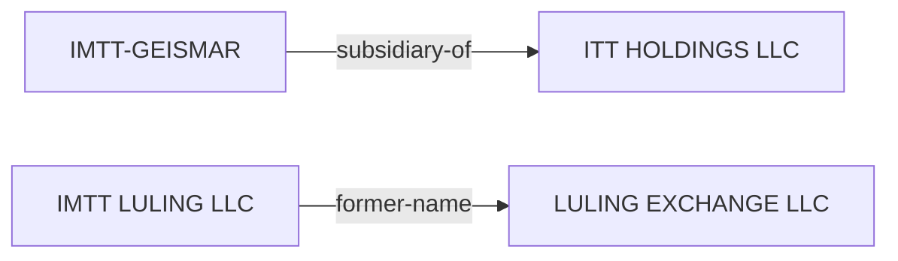

# Louisiana Power Map

Answers three questions about a company seeking a permit, a tax exemption, or a rule change in Louisiana:

1. **Who lobbies for it?** Louisiana Ethics Administration lobbyist registrations (scripted).
2. **Who has it given money to?** Louisiana Ethics Administration e-filed campaign contributions (scripted).
3. **Who owns and runs it?** OpenCorporates' mirror of the Louisiana business registry first (scripted), then parents and subsidiaries from GLEIF and SEC Exhibit 21 (scripted), then the Secretary of State filings themselves (manual: the search is reCAPTCHA-gated). The chain goes into the case folder's `ENTITIES.md`.

For the tax exemption itself (the ITEP, Quality Jobs or Enterprise Zone contract, the board vote, local recommendations), use `bayou:itep-lookup`.

This skill retrieves records. It does not conclude that a contribution bought a vote or that a lobbyist caused a decision. Report what was filed, by whom, and when, and let the user draw the line between a contribution and an official act.

## Parsing arguments

- **Company name** (required). Ask for the exact legal name on the permit application and any known parent, subsidiary, or former name. Run each as its own search: the applicant on an LDEQ permit is often an LLC whose name differs from the parent that hires the lobbyists (the registered client for Denka's LaPlace plant is "Denka Performance Elastomer (DPE)"). If the user has no former names to offer, run the Step 3 first pass before Steps 1 and 2: its `Previous Names` and `Branch` fields supply them (Luling Exchange LLC is now IMTT Luling LLC), and each one is another search term for lobbyists and contributions. The land itself is often held by a further entity. `bayou:parish-assessor-gis` (`at` on the site, or `owner` near it) gives the owner of record of the site parcels; search that name too. A tax agent printed "C/O" is not the owner.
- **Date range** (optional) for contributions, as `MM/DD/YYYY`.
- **Officials of interest** (optional): legislators, parish council members, or statewide officials whose filings should be picked out of the contribution results.

## Step 1: Registered lobbyists

```bash
python3 "${CLAUDE_PLUGIN_ROOT}/skills/la-power-map/ethics_search.py" lobbyists "Denka"
python3 "${CLAUDE_PLUGIN_ROOT}/skills/la-power-map/ethics_search.py" lobbyists "Denka" --past
```

Returns CSV: `company, paid, branch, lobbyist, dates_represented`. The match is a substring of the company name as the lobbyist typed it on the registration. `--past` adds representations that have ended. `branch` says where the lobbyist is registered to work: Legislative, Executive (state agencies, which includes LDEQ and the Department of Conservation and Energy), or Local.

Then, for each lobbyist found, search the lobbyist's other clients in the browser at `https://ethics.la.gov/LobbyistData/SearchByLobbyist.aspx`. A lobbyist shared with a trade association or with another applicant in the same parish is often the more useful finding.

What the registration does not show: how much the company pays the lobbyist, or which bill or permit was discussed. Lobbyist expenditure reports (`SearchByFinancialDisclosure.aspx`) list spending *on officials* such as meals and events, not fees received.

## Step 2: Campaign contributions

```bash
python3 "${CLAUDE_PLUGIN_ROOT}/skills/la-power-map/ethics_search.py" contributions "Entergy" --from 01/01/2026 > contributions.csv
```

Returns the portal's own CSV export: filer (the candidate or committee that *received* the money), report number, contributor name and address, contribution type, date, and amount. The total number of matching records and the number inside the date range are printed to stderr.

Read the results before reporting them:

- **The match is a substring, and it is loose.** A search for "Denka" returns MLADENKA and GUDENKAUF and no Denka contributions at all. A search for "Entergy" returns "ATMOS ENTERGY CORPORATION" (a filer's misspelling of Atmos Energy) and an unrelated "TCHEFUNCTE ENTERGY LLC". Filter the CSV to rows whose `ContributorName` is the company, its PAC, or a named officer, and say how many rows were dropped.
- **Most corporate money moves through a PAC.** Search the PAC by its own name ("ENPAC" for Entergy). The Ethics Administration's PAC list is at `https://ethics.la.gov/CampaignFinanceSearch/PACLists.aspx`. Contributor names are typed by each recipient's treasurer, so one PAC appears under several spellings; group them by address.
- **Executives give in their own names.** Search officers found in Step 3 individually, and match on address or employer before attributing a gift to the company. A common surname alone is not a match.
- **Zero rows is not zero giving.** Only electronically filed reports are searchable. Older and some local filings exist only as scanned PDFs (`SearchScanned.aspx`).
- `ContributionType` values other than `CONTRIB` (for example `OTHER`, a utility refund to a campaign) are not political gifts. Drop them or label them.

To see every contribution a specific official received, use the browser form at `https://www.ethics.la.gov/CampaignFinanceSearch/SearchEfilingContributors.aspx` and pick the filer.

## Step 3: Ownership and officers

### First pass: OpenCorporates mirror (scripted)

OpenCorporates republishes the Louisiana Secretary of State registry and serves it without a CAPTCHA or a login. Search by name, then read the detail page of each entity that is the applicant:

```bash
curl -sS -L --get --data-urlencode "q=Luling Exchange" https://opencorporates.com/companies/us_la \
  | grep -oE "Found [0-9,]+ companies|/companies/us_la/[^\"]+\" title=\"[^\"]*\""

curl -sS -L https://opencorporates.com/companies/us_la/45557942Q | python3 -c '
import html, re, sys
page = sys.stdin.read()
text = lambda s: " ".join(html.unescape(re.sub(r"<[^>]+>", " ", s)).split())
for dt, dd in re.findall(r"<dt[^>]*>(.*?)</dt>\s*<dd[^>]*>(.*?)</dd>", page, re.S):
    print(text(dt) + ": " + text(dd))'
```

The search prints the hit count and one line per entity with its company number and name. `Found 0 companies` and nothing else means no match. The search matches former names as well as current ones, which is how "Luling Exchange" finds IMTT LULING LLC, and it is loose: "Entergy" returns 82 entities, among them ADT Security Services. Only the first 30 are shown, so when the count is higher, search a longer piece of the legal name instead of paging.

What the detail page gives without a login:

- **Company Number**: the number to search by in the manual step below. Check that it is the charter number shown on the Secretary of State page before citing it as one.
- **Status** and **Company Type**. "(Non-Louisiana)" in the type marks a foreign entity.
- **Branch**: for a foreign entity, the home-state entity it is registered as a branch of, for example `Branch of LULING EXCHANGE LLC (Delaware (US))`. This names the entity and the state to look in for owners.
- **Registered Address**, **Agent Name**, and **Agent Address**.
- **Previous Names**. Feed each one back into Steps 1 and 2.
- **Directors / Officers**: the count only.

What it withholds (`Please log in to see this data`): officer and manager names, the incorporation date, and the date the record was last refreshed from the state. Because the refresh date is hidden, there is no way to tell how stale the mirror is. Treat status and agent as leads, and confirm them against the Secretary of State before they go into a comment letter.

Keep to one search page and one detail page per entity. The site's `robots.txt` disallows paged results (`?page=`) and the `/officers` and `/search` paths.

### Second pass: parents and subsidiaries (scripted)

Two free sources name corporate parents without a login. Run both on the applicant, on the home-state entity from the first pass's `Branch` field, and on the parcel owner:

```bash
python3 "${CLAUDE_PLUGIN_ROOT}/skills/la-power-map/entity_search.py" gleif "IMTT"
python3 "${CLAUDE_PLUGIN_ROOT}/skills/la-power-map/entity_search.py" gleif-children 7QEON6Y1RL5XR3R1W237 --region US-LA
python3 "${CLAUDE_PLUGIN_ROOT}/skills/la-power-map/entity_search.py" ex21 "IMTT" --from 2015
```

- **`gleif <name>`** searches the Global LEI Index and returns `lei, legal_name, status, legal_jurisdiction, hq_region, direct_parent, ultimate_parent, exception_reason`. A parent is printed as `NAME (LEI)`. When an entity declined to name a parent, `exception_reason` says why, and the reason is itself a finding: `NATURAL_PERSONS` (owned by individuals), `NON_CONSOLIDATING` (the owner does not consolidate it in its accounts, typical of private-equity and joint-venture ownership), `NON_PUBLIC` (the owner exists but the entity will not disclose it), `NO_KNOWN_PERSON`. Example: IMTT-GEISMAR reports direct parent ITT HOLDINGS LLC and withholds its ultimate parent as `NON_PUBLIC`.
- **`gleif-children <LEI> [--region US-LA]`** lists the entities that report a given parent. Use it from the other end: start at a known foreign or national parent (Hyundai Steel, POSCO, Lotte, Air Products) and look for its Louisiana operating entities. `--region` matches either the legal or the headquarters address.
- **`ex21 <name> [--from YYYY] [--to YYYY]`** searches SEC EDGAR full text and keeps only hits inside Exhibit 21, the subsidiary list a public company attaches to its 10-K. Each row is a parent that listed the name: filer, CIK, form, filing date, and the exhibit URL. Open the exhibit to read the exact subsidiary name and its state of organization. The run of years shows when the parent held it: Macquarie Infrastructure's Exhibit 21 lists IMTT-Geismar, IMTT-Gretna and the other IMTT entities in each 10-K through the one filed in February 2020; the run ends with the sale of IMTT to Riverstone in December 2020.

Limits, stated in any write-up that relies on these:

- **GLEIF covers only entities that obtained an LEI**, which is required mainly for financial-market activity. IMTT-Geismar has one; the Luling entity was not found. Zero hits proves nothing about ownership.
- **Exhibit 21 exists only for SEC-registered parents.** A private-equity owner (Riverstone), a family-held company, or a foreign parent that files no 20-F appears in neither source. Fall back to the parent's or the buyer's press releases with WebSearch, and cite them as press, not as a registry.
- **Exhibit 21 may omit insignificant subsidiaries** (SEC rules allow it), so a missing name in one year is not proof of a sale.
- **GLEIF fulltext also matches other names and addresses.** "Esperanza Investments" returns D&M Capital Investments, LLC of Oklahoma; the script flags any hit whose legal name does not contain the search term. Discard those unless the record ties back to the applicant.
- **The EDGAR match is on the quoted phrase.** A short name like "IMTT" also matches unrelated filers; read the filer column before attributing.

### Secretary of State (manual)

The Secretary of State's business search at `https://coraweb.sos.la.gov/commercialsearch/commercialsearch.aspx` sits behind Google reCAPTCHA. Do not try to script it. It is the only source here for officer and manager names, and the record that confirms what the first pass returned. Give the user this path and ask them to paste back or screenshot the detail page:

1. Open the URL, search by entity name or by the company number from the first pass, and solve the CAPTCHA.
2. Open the entity's detail page and record: charter number, entity type, status (Active / Not in good standing), domicile or home state, registered agent, and every officer or manager with an address.
3. For a foreign (out-of-state) LLC the Louisiana filing names only managers and an agent. The owners are on file, if anywhere, in the home state (often Delaware, which does not publish them). The first pass's `Branch` field names that home-state entity.

Other routes to the parent, all scriptable or already in this plugin:

- `/bayou:epa-tri-search`: each TRI facility record carries `parent_co_name`.
- `ex21` above covers the Exhibit 21 lookup. For a parent's enforcement history and disclosed liabilities, use `/bayou:doj-sec-search`.

## Dead ends

- **`ResultsByCompRep.aspx?SearchParams=RepName.{Name},` as a direct link.** The lobbyist form redirects to this URL, which looks bookmarkable. Requested without the session that made the search, it returns every registration on file (600+ pages) instead of the filtered set, with no error. `ethics_search.py` posts the form and exits with a message if it sees the unfiltered list.
- **Date boxes on the contribution form.** They are Telerik widgets whose state is assembled in the browser; posting the date text alone is ignored. The script applies the date range to the exported CSV instead.
- **Campaign-finance search page size.** The search page embeds every filer name and weighs about 2.5 MB with a 1.4 MB ViewState that must be posted back. A search takes 20 to 60 seconds. This is slow, not blocked.
- **OpenCorporates API without a token.** `https://api.opencorporates.com/v0.4/companies/search` returns 401 `Invalid Api Token` for an anonymous request (confirmed 2026-10-12). The website pages in Step 3 need no token.
- **Officer names from OpenCorporates.** The detail page shows how many officers are on file and puts the names behind a login. The Secretary of State page is the route to them.
- **`doj-sec-search` for subsidiary lookup.** It is the enforcement and disclosure skill and does not filter hits to Exhibit 21. Use `entity_search.py ex21` for subsidiary lookup.
- **EDGAR `forms=10-K,10-K/A`.** Including `10-K/A` in the form list collapses the result set (184 hits for "IMTT" become 6, confirmed 2026-10-22). The script leaves amendments out.
- **Federal giving is not here.** Contributions to congressional candidates are filed with the FEC (`https://www.fec.gov/data/`), and federal lobbying with the Senate (`https://lda.senate.gov/`). Neither is wrapped by this skill.

## Presenting the results

1. **Lobbyists**: Company as registered | Lobbyist | Branch | Dates. Note which searches included past representations.
2. **Contributions**: Recipient | Contributor as written | Date | Amount | Report number, with a total per recipient. State the search terms, the date range, and how many returned rows were excluded as non-matches.
3. **Ownership**: the OpenCorporates fields, labeled as a mirror of the state registry, and separately what the user retrieved from the Secretary of State, or a statement that the state record was not retrieved. Say which fields were confirmed against the state record and which rest on the mirror alone.
4. Retrieval date for each source.
5. **`ENTITIES.md`** in the case folder (for example `esperanza/datacenter/ENTITIES.md`), described below.

### ENTITIES.md: the case's ownership map

One file per case folder, one row per relationship, every row sourced. Create it if it does not exist. When it exists, read it first and append new rows; never rewrite or delete rows the user wrote, and if a new record contradicts an existing row, add the new row and tell the user about the conflict.

```markdown
# Entities: <case name>

| From | Relation | To | Source | Confirmed? | Retrieved |
|---|---|---|---|---|---|
| IMTT-GEISMAR | subsidiary-of | ITT HOLDINGS LLC | GLEIF LEI 549300O1SKAQ3V811J37 | registry | 2026-10-22 |
| IMTT-GEISMAR | ultimate-parent | (withheld: NON_PUBLIC) | GLEIF reporting exception | registry | 2026-10-22 |
| IMTT LULING LLC | former-name | LULING EXCHANGE LLC | OpenCorporates 45557942Q | mirror only | 2026-10-12 |
| IMTT LULING LLC | registered-agent | C T CORPORATION SYSTEM | OpenCorporates 45557942Q | mirror only | 2026-10-12 |
| IMTT LULING LLC | manager/officer | (pending SOS lookup) | Secretary of State | pending | |
```

- **Relation** is one of: `applicant-for` (To is the permit number), `owns-parcel` (To is the parcel ID), `branch-of`, `subsidiary-of`, `ultimate-parent`, `registered-agent`, `manager/officer`, `former-name`, `lobbyist-for`, `contributed-to`.
- **Confirmed?** is `state record` (seen on the issuing agency's own record: the Secretary of State page, an LDEQ permit file, the parish assessor layer), `registry` (GLEIF or an SEC filing), `mirror only` (OpenCorporates), `press only` (news or a company press release), or `pending`.
- **`owns-parcel` rows** come from `bayou:parish-assessor-gis` and follow its privacy rule: list corporate owners only. Where an individual co-owns a parcel with a company, record the company and write `(individual co-owner, not named)`. Never put a resident's or individual owner's name in this file.
- **`manager/officer` rows** name officers of the company as filed with the state. They are public business records, but list them only when the Secretary of State page was retrieved, and mark them `state record`.
- Lobbyist and contribution rows summarize Steps 1 and 2; the full tables stay in the report.

Optionally close the file with a Mermaid diagram generated from the table, one edge per row, so the chain renders on GitHub and in most Markdown viewers:

````markdown

````

### Citation format

> **Louisiana Board of Ethics, Lobbyist Registration**, Denka Performance Elastomer (DPE), lobbyist Donelson T. Caffery III, Legislative and Executive, registered 03/21/2024 to present, source: [Lobbyist Data Search](https://ethics.la.gov/LobbyistData/SearchByCompRep.aspx) (retrieved 2026-10-11).
>
> **Louisiana Board of Ethics, Campaign Finance Report** LA-133486 (Form 202), New Orleans Hospitality Coalition PAC, contribution of $104.00 from Entergy Corporation dated 03/13/2026, source: [Campaign Finance Search](https://www.ethics.la.gov/CampaignFinanceSearch/SearchEfilingContributors.aspx) (retrieved 2026-10-11).
>
> **OpenCorporates, mirror of the Louisiana Secretary of State business registry**, IMTT Luling LLC (formerly Luling Exchange LLC), company number 45557942Q, Limited Liability Company (Non-Louisiana), Active In Good Standing, branch of Luling Exchange LLC (Delaware), registered agent C T Corporation System, source: [OpenCorporates](https://opencorporates.com/companies/us_la/45557942Q) (retrieved 2026-10-12; not confirmed against the Secretary of State record).
>
> **GLEIF, Global LEI Index**, IMTT-GEISMAR, LEI 549300O1SKAQ3V811J37, direct parent ITT HOLDINGS LLC (LEI 549300TH2PHOLK31LB42), ultimate parent not disclosed (reporting exception: NON_PUBLIC), source: [GLEIF](https://search.gleif.org/#/record/549300O1SKAQ3V811J37) (retrieved 2026-10-22).
>
> **SEC EDGAR, Macquarie Infrastructure Corp, Form 10-K for 2019, Exhibit 21.1 (List of Subsidiaries)**, filed 2020-02-25, CIK 1289790, lists IMTT-Geismar (Delaware) among its subsidiaries, source: [EDGAR](https://www.sec.gov/Archives/edgar/data/1289790/000162828020002149/mic-20191231x10kxex211.htm) (retrieved 2026-10-22).

$ARGUMENTS
